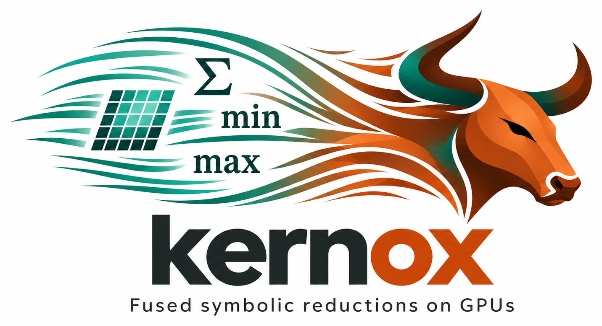

# kernox

<p align="center">
  
</p>

kernox computes pairwise reductions on GPUs and CPUs (Gaussian kernel sums, nearest
neighbours, log-sum-exp, softmax-weighted sums, ...) without ever building the
M×N matrix. You write the formula with symbolic variables indexed by `i` and
`j`, and kernox turns it into a single fused GPU kernel for NVIDIA (CUDA),
AMD (ROCm/HIP) or Intel (SYCL) cards, or into vectorized multithreaded C++ on
x86-64 CPUs. One reduction can also be split across several GPUs or nodes,
from a laptop script to a cluster job. Support for other architectures and
accelerators may be added later.

kernox is a successor to [PyKeOps](https://github.com/getkeops/keops), built on
the [symox](https://github.com/keckj/symox) symbolic engine. It works with
PyTorch tensors.

- Documentation: <https://keckj.github.io/kernox/>
- Getting started: <https://keckj.github.io/kernox/getting-started/>

## Why kernox

- **No M×N matrix.** Memory stays linear in the number of points, so each row
  can be reduced over millions of points.
- **Three GPU vendors and the CPU.** One formula runs on NVIDIA, AMD and Intel
  GPUs, and on x86-64 CPUs (OpenMP, SIMD).
- **Several GPUs or nodes.** `kernox.distributed` splits a reduction across
  the processes of a `torch.distributed` group (NCCL between GPUs, Gloo
  between CPU nodes), with gradients. The same script runs alone or under
  `torchrun`, `mpirun` or `srun`, without `mpi4py`.
- **Formulas, not strings.** Formulas are Python expressions. Derivatives are
  computed symbolically and run as fused reductions too.
- **Predictable numerics.** IEEE arithmetic by default, an explicit opt-in for
  approximate `exp` and `log`, and an explicit error instead of a silent
  fallback when something is not supported.
- **Familiar to PyKeOps users.** The PyKeOps reductions and formula operations
  are available for PyTorch on GPUs and CPUs. kernox has no NumPy interface;
  the other differences are listed in
  [Coming from PyKeOps](docs/pykeops.md).

## Installation

kernox needs Python 3.10 or later, PyTorch, and a supported GPU or an x86-64
Linux CPU with `g++` 12 or later. Install PyTorch
for your platform first, then kernox from PyPI (symox, its symbolic engine, comes
with it as a dependency):

```sh
pip install torch --index-url https://download.pytorch.org/whl/cu126   # NVIDIA
pip install "kernox[cuda]"
python -m kernox.diagnostics --check
```

On the CPU only:

```sh
pip install torch --index-url https://download.pytorch.org/whl/cpu
pip install kernox
```

AMD and Intel instructions, and the details, are in
[Getting started](docs/getting-started.md).

## Performance

The goal of kernox is to be **at least as fast as PyKeOps** wherever PyKeOps
runs, and to bring the same performance to AMD and Intel GPUs, which PyKeOps
does not support. In every case measured so far, kernox is faster.


Speed-up of kernox (PyKeOps time / kernox time), M = N = 10⁵, FP32, median
of three runs. On an RTX 5090, kernox runs with `fast_math=True`. On the CPU
(2 × AMD EPYC 9654, 192 cores), both sides use IEEE arithmetic, and kernox
uses every core and SIMD instructions (AVX2, AVX-512) with glibc's vectorized
math functions. PyKeOps 2.3 runs through `Genred` in its best configuration
(each kernel compiled alone in a fresh process). These figures cover only the
cases listed; they are not a general claim of superiority over PyKeOps on
every workload or card. A case where kernox is slower than PyKeOps is treated
as a bug. The times and how to reproduce them are in
[Coming from PyKeOps](docs/pykeops.md#performance).

On the same CPU node, kernox is 50 to 113 times faster than PyTorch computing
the distance matrix by blocks (FP32, M = N = 20,000). Details, thread scaling
and larger sizes: [CPU backend](docs/backend-cpu.md).

### Several GPUs or nodes

Strong scaling of a Gaussian kernel product in D = 3, FP32, forward and
backward, split with `kernox.distributed`. The block-sparse case keeps, for
each point, the 27 neighbouring cells of a grid (2.7 × 10¹² pairs for 10⁸
points). Speed-up = time on one device / time on P devices:


All the measurements, and when splitting pays:
[Several GPUs or nodes](docs/guides/distributed.md#scaling).

## Learn more

- [Getting started](docs/getting-started.md): installation and a first
  reduction, step by step.
- [Concepts](docs/concepts.md): variables, formulas, reductions, devices and
  dtypes.
- How-to guides: [kernel sums](docs/guides/kernel-sums.md),
  [nearest neighbours](docs/guides/nearest-neighbours.md),
  [log-sum-exp and Sinkhorn](docs/guides/logsumexp.md),
  [gradients](docs/guides/gradients.md),
  [linear systems](docs/guides/linear-systems.md),
  [several GPUs or nodes](docs/guides/distributed.md) and more.
- [Running on a cluster](docs/guides/cluster.md): a script tested on a
  laptop, then launched with `torchrun`, SLURM, OAR or `mpirun`, step by step.
- [Coming from PyKeOps](docs/pykeops.md): a migration guide.
- [Backends and hardware](docs/backends.md): what runs where, and the known
  limitations.
- [CPU backend](docs/backend-cpu.md): how the CPU kernels are built, and
  measured performance.

## About the name and logo

symox is *symbolic* plus *ox*: a rusty ox, since symox is written in Rust.
kernox is *kernels* plus the ox of symox, and also a nod to the redox chemistry
of copper. The logo goes from orange copper (the ox) to turquoise verdigris
(the trails and the compute grid), that is, from copper to its oxidation
patina. And redox contains *reduction*, which is what kernox does: sum, min and
max, as drawn in the logo.

## License

At your option, [MIT](LICENSE-MIT) or [Apache-2.0](LICENSE-APACHE).
Provenance of third-party code and algorithms (KeOps, symox):
[`THIRD_PARTY.md`](THIRD_PARTY.md).

## Projects using kernox

- [remblais](https://github.com/keckj/remblais): a faster GeomLoss (Sinkhorn
  divergences, kernel norms and optimal transport) on NVIDIA, AMD and Intel
  GPUs and on CPUs. Documentation: <https://keckj.github.io/remblais/>

## Related projects

- symox, symbolic engine and code generation: <https://github.com/keckj/symox>
- KeOps / PyKeOps: <https://github.com/getkeops/keops>
